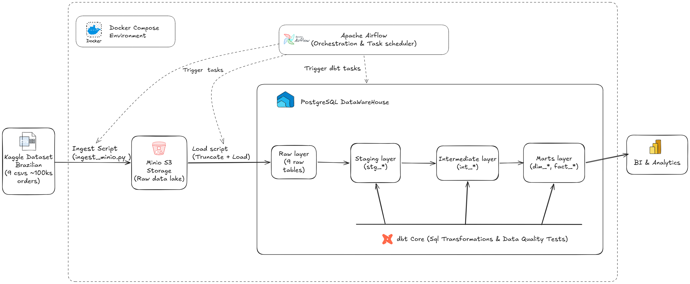
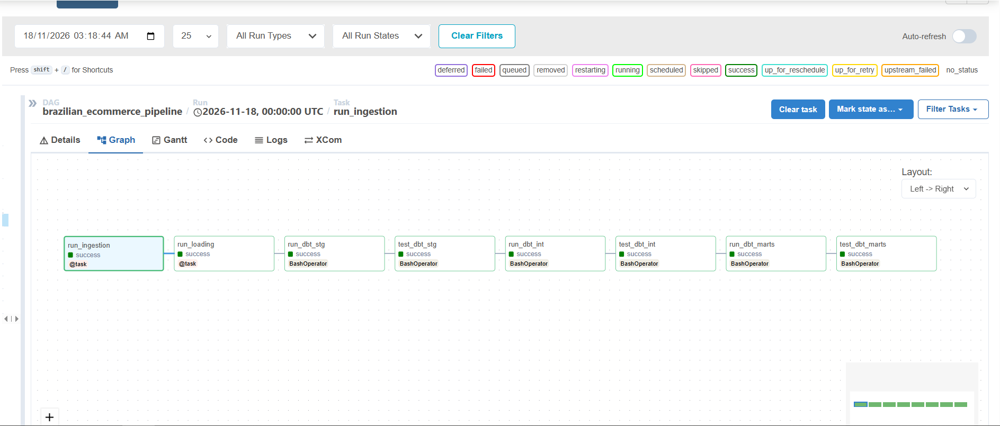
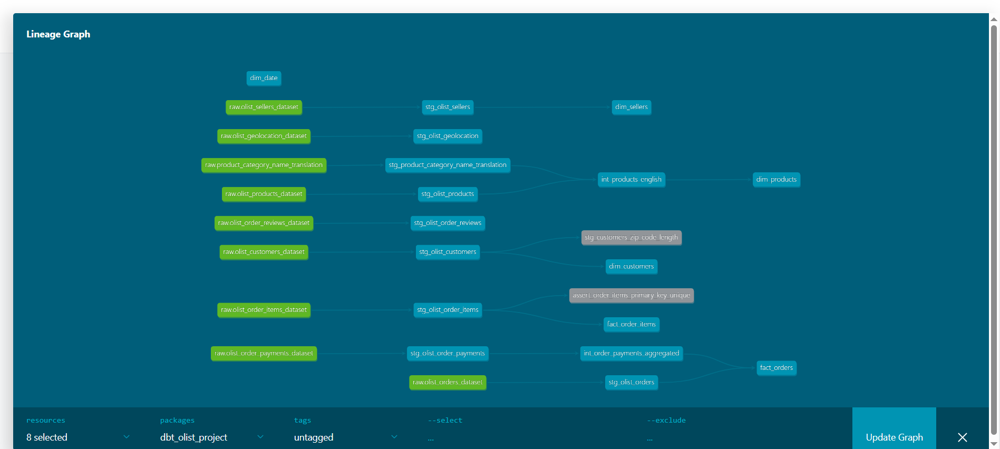

# 🚀 Brazilian E-Commerce End-to-End ETL Pipeline 

> A robust, production-grade Data Engineering pipeline built to process, transform, and model the Olist Brazilian E-Commerce dataset (~100k orders) using modern Data Lakehouse & ELT patterns[cite: 5].

---

## 🏗️ System Architecture


The pipeline follows the **Medallion Architecture (Bronze $\rightarrow$ Silver $\rightarrow$ Gold)**, containerized via **Docker Compose**, orchestrated by **Apache Airflow**, and transformed using **dbt Core** inside a PostgreSQL Data Warehouse.




## 🛠️ Tech Stack & Tools

* **Orchestration:** Apache Airflow (Task scheduling & DAG management)[cite: 5].
* **Storage (Data Lake):** MinIO (S3-compatible Object Storage for Raw data)[cite: 5].
* **Database (Data Warehouse):** PostgreSQL[cite: 4, 5].
* **Transformation & Testing:** dbt Core (SQL-based modular transformations & data quality testing).
* **Environment:** Docker & Docker Compose (Containerized infrastructure)[cite: 3, 4, 5].
* **Business Intelligence:** Microsoft Power BI.
* **Language:** Python.


## 🖥️ Pipeline Execution & BI Visualization

End-to-end verification of the data pipeline execution, data lineage, and business intelligence reporting:

### 1. Apache Airflow Orchestration
* **Interface:** `http://localhost:8080` — Automated daily scheduling and execution monitoring across ingestion, loading, dbt transformations, and data quality tests.



### 2. dbt Data Lineage & Documentation
* **Interface:** `http://localhost:8081` (`dbt docs serve`) — End-to-end dependency graph mapping raw sources through staging and intermediate layers into the final Star Schema marts.



### 3. Power BI Analytics Dashboard *(Coming Soon)*
* **Source:** Connected directly to PostgreSQL `gold_mart` / `03_marts` schema — Tracking revenue trends, delivery SLA performance, and customer RFM segmentation.

---UPDATING...---

---

## 📁 Project Structure

```text
brazilian-ecommerce-pipeline/
├── config/
│   ├── settings.py                   # Centralized connection configs
│   └── logger.py                     # Standardized logging configuration for ETL scripts & pipeline monitoring
├── dags/                             # Apache Airflow DAG orchestrating the end-to-end workflow
│   └── airflow.py                    # Main DAG definition scheduling ingestion, loading, dbt tasks and tests
├── dashboard/                        # Power BI dashboard files & visualizations connected to `gold_mart`
├── data/
│   └── raw/                          # Raw Olist CSV files downloaded from Kaggle
├── dbt_olist_project/                # dbt Core project for modular SQL transformations & testing
│   ├── .dbt/                         # Local dbt profile connection configuration (profiles.yml)
│   ├── dbt_packages/                 # External dbt packages installed via `dbt deps` (e.g., dbt_utils)
│   ├── macros/                       # Reusable Jinja SQL functions & custom generic test definitions
│   ├── dbt_project.yml               # Project configuration, schema routing, and materialization settings
│   ├── models/
│   │   ├── 01_staging/               # Raw source definitions (_sources.yml), 1-to-1 standardized staging models & column 
|   |   |                               tests (stg_olist_*.sql / .yml)
│   │   ├── 02_intermediate/          # Pre-aggregated payments & translated product lookups (int_order_payments_aggregated, 
|   |   |                               int_products_english)
│   │   └── 03_marts/                 # Star Schema dimensions, fact tables & mart-level tests (dim_*, fact_*, schema.yml)
│   └── tests/                        # Singular SQL data quality tests
├── docs/                             # Architecture diagrams, Airflow & dbt execution screenshots for documentation
├── images/                           # Custom Dockerfiles extending base service images with project dependencies
│   ├── airflow/
│   │   └── Dockerfile                # Custom Airflow image 
│   └── jupyter/
│       └── Dockerfile                # Custom JupyterLab image 
├── notebooks/                        
├── scripts/
│   └── ingestion/
│       ├── ingest_minio.py           # Uploads csvs file to MinIO storage
│       ├── load_to_raw.py            # Read files from MinIO and loads into Postgres `raw` schema
│       └── init_postgres.sql         # Initializes raw schema & create tables
├── .env                              # Local environment variables & credentials 
├── .env.example                      # Template for required environment variables
├── docker-compose.yml                # Multi-container orchestration (PostgreSQL, MinIO, Airflow, Jupyter)
├── Makefile                          # Shortcut CLI commands for Docker setup
├── README.md                         # Comprehensive project documentation
└── requirements.txt                  # Python dependencies

---

📊 Data Modeling & Transformation Strategy
The project implements Dimensional Modeling (Kimball Methodology) inside the PostgreSQL Data Warehouse through three dbt layers:

     1. Staging Layer (stg_*): Direct views/tables over the raw schema. Handles data type casting, column standardizations (snake_case), and basic null filtering.

     2. Intermediate Layer (int_*): Modular SQL blocks joining staging models (e.g., combining orders, order items, and payments) to compute intermediate metrics.

     3. Marts Layer (dim_*, fct_*): Final business-ready star schema:

          Dimensions (dim_customers, dim_products, dim_sellers): Contextual attributes for filtering and grouping.

          Facts (fct_orders): Granular transactional metrics (freight value, delivery time, review scores) optimized for BI analytical queries.


🧪 Data Quality & Testing
Data integrity is verified automatically via dbt tests running after model generation:

     Generic tests: unique, not_null, accepted_values, and relationships (foreign key constraints) implemented across all dimension and fact tables.
---
🚀 Quick Start & Installation

1. Prerequisites
Docker & Docker Compose installed on your local machine.
Python 3.10+.

2. Clone the Repository
git clone [https://github.com/Huyhvb2505/brazilian-ecommerce-pipeline.git](https://github.com/Huyhvb2505/brazilian-ecommerce-pipeline.git)
cd brazilian-ecommerce-pipeline

3. Configure Environment VariablesCopy the template file and fill in your credentials:Bashcp .env.example .env

4. Spin up InfrastructureLaunch all services (Airflow, PostgreSQL, MinIO) via Docker Compose:Bashdocker-compose up -d

5. Run the PipelineAccess the Apache Airflow UI at http://localhost:8080.Enable and trigger the brazilian_ecommerce_elt DAG.
Monitor tasks execution: Ingestion $\rightarrow$ Loading $\rightarrow$ dbt Run & Test.📸 Pipeline Execution ProofAirflow DAG Success Run(Chèn ảnh chụp màn hình Airflow DAG chạy xanh mượt vào đây)dbt Lineage Graph(Chèn ảnh chụp màn hình dbt docs lineage graph vào đây)

---
## 🤝 Connect
👤 Author: [Hoang Vo Ba Huy](https://www.linkedin.com/in/huy-ho%C3%A0ng-v%C3%B5-b%C3%A1-6bab671a6/) | [GitHub](https://github.com/Huyhvb2505) 
     